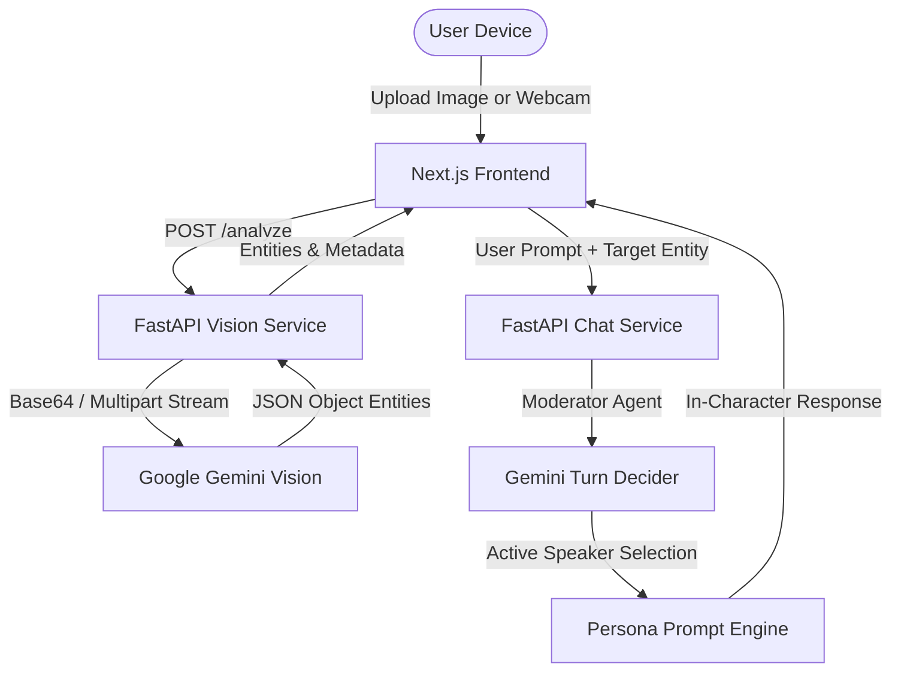
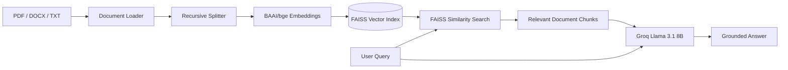

# OpenLense 🔍

[](https://nextjs.org/)
[](https://fastapi.tiangolo.com/)
[](https://ai.google.dev/)
[](https://groq.com/)
[](https://github.com/facebookresearch/faiss)
[](LICENSE)

> **See deeper. Understand faster.**  
> An intelligent multimodal AI platform combining **Visual Entity Persona Conversations** and **Document Retrieval-Augmented Generation (RAG)**.

---

## 🌟 Overview

**OpenLense** bridges computer vision and retrieval-augmented language models into a cohesive, interactive workspace. Instead of static analyses or one-way chat bots, OpenLense allows you to:

1. **Converse with Objects in Photos**: Take or upload a photo, automatically identify prominent objects via Google Gemini Vision, and hold group chats where objects adopt distinct first-person personas with an AI moderator managing conversation turns.
2. **Chat with Complex Documents**: Ingest PDF, Word (.docx), and text files into a high-performance FAISS vector store with HuggingFace embeddings (`BAAI/bge-base-en-v1.5`), querying them with near-instant responses powered by Llama 3.1 on Groq Cloud.

---

## 📸 Key Features

| Feature | Description | Engine / Model |
| :--- | :--- | :--- |
| 👁️ **Visual Entity Segmentation** | Detects, isolates, and attributes 1-5 prominent objects in photos or camera captures. | Google Gemini Flash |
| 🎭 **Multi-Entity Persona Chat** | Talk to objects as individual characters or address the whole room with automated speaker moderation. | Gemini Persona Agents |
| 📚 **Document RAG Ingestion** | Chunks documents using recursive character splitters and indexes dense embeddings into FAISS. | BAAI/bge-base-en-v1.5 |
| ⚡ **Instant Q&A with Citations** | Strict context-grounded Q&A preventing hallucinations. | Llama 3.1 8B Instant via Groq |
| 🖥️ **Fullstack Modern UI** | Polished dark/light interface built with Next.js App Router, Radix UI, and Tailwind CSS. | Next.js 14 + TypeScript |
| 🐳 **Containerized Setup** | Ready for production deployment with Docker and Docker Compose. | Docker / Compose |

---

## 📐 System Architecture

### 1. Vision & Multi-Entity Conversation Pipeline



### 2. Document Ingestion & RAG Retrieval Pipeline



---

## 📂 Repository Structure

```
OpenLense/
├── backend/                        # FastAPI Backend Engine
│   ├── api/                        # API router aggregator
│   ├── auth/                       # Security & JWT authentication utilities
│   ├── experts/                    # Specialized AI agent services
│   │   ├── chat_expert.py          # Vision entity extraction & multi-entity chat (Port 8001)
│   │   ├── rag_expert.py           # Document ingestion & FAISS RAG Q&A (Port 8002)
│   │   ├── vision.py               # Vision utilities
│   │   └── uploads/                # Ephemeral image upload store
│   ├── dependencies.py             # FastAPI dependency injection
│   ├── main.py                     # Unified backend application & dual-service launcher
│   ├── requirements.txt            # Python dependencies
│   ├── Dockerfile                  # Backend container specification
│   └── .env.example                # Backend environment template
│
├── frontend/                       # Next.js 14 App Router UI
│   ├── app/
│   │   ├── conversation-objects/   # Object persona conversation interface
│   │   ├── chat-document/          # Document upload & RAG chat interface
│   │   ├── page.tsx                # Landing page & feature showcase
│   │   └── globals.css             # Design tokens & styles
│   ├── components/                 # Reusable UI & chat components
│   ├── lib/
│   │   ├── config.ts               # Dynamic API endpoint configuration
│   │   ├── api.ts                  # Typed client service
│   │   └── utils.ts                # Tailwind & UI helpers
│   ├── package.json                # Frontend dependencies
│   ├── Dockerfile                  # Multi-stage production container
│   └── .env.example                # Frontend environment template
│
├── .github/workflows/              # CI/CD Workflows
│   └── ci.yml                      # Automated linting & build verification
├── docker-compose.yml              # Multi-container orchestration
├── requirements.txt                # Root Python dependencies
├── .env.example                    # Global environment configuration guide
├── CONTRIBUTING.md                 # Contribution guidelines
├── LICENSE                         # MIT License
└── README.md                       # Documentation
```

---

## 🚀 Quick Start Guide

### Option A: Running with Docker Compose (Recommended)

1. **Clone the repository**:
   ```bash
   git clone https://github.com/kanakkadulkar/OpenLense-Media.Net.git
   cd OpenLense-Media.Net
   ```

2. **Configure environment keys**:
   ```bash
   cp backend/.env.example backend/.env
   ```
   Add your `GOOGLE_API_KEY` and `GROQ_API_KEY` to `backend/.env`.

3. **Start the containers**:
   ```bash
   docker compose up --build
   ```

4. Open your browser:
   - **Frontend App**: [http://localhost:3000](http://localhost:3000)
   - **Backend API Docs**: [http://localhost:8000/docs](http://localhost:8000/docs)

---

### Option B: Local Development Setup

#### 1. Backend Setup

```bash
cd backend

# Create and activate a Python virtual environment
python3 -m venv venv
source venv/bin/activate       # On Windows: venv\Scripts\activate

# Install dependencies
pip install -r requirements.txt

# Configure environment variables
cp .env.example .env
```

Edit `backend/.env` with your API keys:
```env
GOOGLE_API_KEY=your_gemini_api_key
GROQ_API_KEY=your_groq_api_key
```

**Run the Backend**:
- **Dual-Service Mode** (Runs Vision on `8001` and RAG on `8002` concurrently):
  ```bash
  python main.py --mode=dual
  ```
- **Unified Mode** (Runs all endpoints under a single server on port `8000`):
  ```bash
  python main.py
  ```

Interactive Swagger documentation is available at [http://localhost:8000/docs](http://localhost:8000/docs).

#### 2. Frontend Setup

In a new terminal window:

```bash
cd frontend

# Install Node.js dependencies
npm install

# Configure environment variables
cp .env.example .env.local

# Start the Next.js development server
npm run dev
```

Visit [http://localhost:3000](http://localhost:3000) to view the application.

---

## 🔑 Environment Variables Reference

### Backend (`backend/.env`)

| Variable | Required | Default | Description |
| :--- | :---: | :--- | :--- |
| `GOOGLE_API_KEY` | **Yes** | — | Google Gemini API key for image entity extraction and character persona chat. |
| `GEMINI_MODEL` | No | `gemini-2.5-flash` | Gemini model variant. |
| `GROQ_API_KEY` | **Yes** | — | Groq Cloud API key for ultra-fast Llama 3.1 RAG generation. |
| `EMBEDDING_MODEL` | No | `BAAI/bge-base-en-v1.5` | HuggingFace embedding model for document vectorization. |
| `PORT` | No | `8000` | Port for unified backend mode. |
| `CORS_ORIGINS` | No | `http://localhost:3000` | Comma-separated list of allowed CORS origins. |

### Frontend (`frontend/.env.local`)

| Variable | Required | Default | Description |
| :--- | :---: | :--- | :--- |
| `NEXT_PUBLIC_VISION_API_URL` | No | `http://localhost:8001` | Vision and multi-entity chat endpoint. |
| `NEXT_PUBLIC_RAG_API_URL` | No | `http://127.0.0.1:8002` | Document ingestion and RAG Q&A endpoint. |
| `NEXT_PUBLIC_API_URL` | No | `http://localhost:8000` | Unified API endpoint. |

---

## 📡 API Reference

### Vision & Character Chat
- `POST /analyze`: Upload an image (`multipart/form-data`) to extract recognized objects, categories, and attributes.
- `POST /chat/message`: Send group chat or targeted messages to detected entities. Includes history and recipient entity IDs.

### Document RAG
- `POST /process-documents/`: Upload documents (`.pdf`, `.docx`, `.txt`) with configurable chunk size and embedding model.
- `POST /chat/`: Query the ingested document index with natural language questions.

### System
- `GET /health`: Healthcheck status report.
- `GET /docs`: Interactive OpenAPI documentation and test console.

---

## 🤝 Contributing

Contributions are welcome! Please read the [Contributing Guidelines](CONTRIBUTING.md) to get started.

1. Fork the Project
2. Create your Feature Branch (`git checkout -b feature/AmazingFeature`)
3. Commit your Changes (`git commit -m 'feat: Add some AmazingFeature'`)
4. Push to the Branch (`git push origin feature/AmazingFeature`)
5. Open a Pull Request

---

## 📄 License

Distributed under the **MIT License**. See [`LICENSE`](LICENSE) for details.

---

## 👤 Author

Developed by **[Kanak Kadulkar](https://github.com/kanakkadulkar)**.
